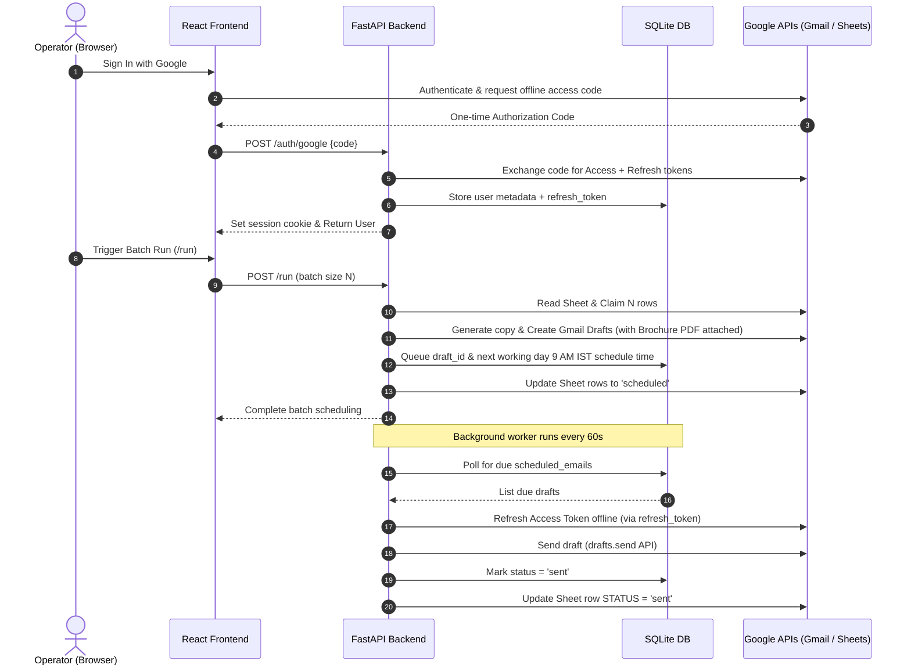

# 🌸 Hello Kitty: Automated cold email outreach pipeline

Hello Kitty is an automated cold outreach pipeline that reads leads from a master Google Sheet, generates highly personalized cold email copy using a Gemini LLM, creates drafts directly in the sender's Gmail account, and automatically schedules them to be dispatched at **9:00 AM IST of the next working day**.

Once triggered, the operator can safely shut down their laptop—our timezone-aware backend worker handles offline OAuth token rotation and schedules dispatch through Gmail's APIs completely server-side.

---

## 🚀 Key Features

*   **Google Sheets Integration**: Automatically claims, locks, and logs outreach progress on a shared Google Sheet.
*   **Gemini-Powered Copywriting**: Leverages Google Gemini to create contextual, personalized, and non-spammy cold emails based on company type.
*   **Draft-First Scheduling**: Automatically creates drafts in your Gmail account immediately so you can preview, edit, or delete them in your **Gmail Drafts** folder before they are sent.
*   **Timezone & Weekday Aware**: Schedules dispatches for exactly **9:00 AM IST of the next working day** (excluding weekends: Friday, Saturday, and Sunday mailings are sent on Monday morning).
*   **Offline Dispatch (No Laptop Required)**: Exchanges OAuth authorization codes for secure refresh tokens, allowing our background service to rotate access tokens offline and send the drafts.
*   **Automated Attachments**: Automatically embeds the local graVITas'26 brochure PDF into all generated drafts.

---

## 🛠️ Technology Stack

| Layer | Technology |
| :--- | :--- |
| **Backend** | Python 3.10+, FastAPI, `aiosqlite` (Async SQLite), `httpx` |
| **Frontend** | React 18, TypeScript 5, Vite 6, TailwindCSS v4 |
| **Databases** | Local SQLite (`hellokitty.db`) for queue management and session persistence |
| **Third-Party APIs** | Google Gmail API, Google Sheets API v4, Google Gemini Pro |

---

## 📐 Architecture & Workflow



---

## 📦 Project Structure

```
├── services/
│   ├── claims.py          # /run orchestration pipeline (claims, draft creation, queueing)
│   ├── gmail.py           # Gmail API wrappers (create_draft, send_draft)
│   ├── sheets.py          # Google Sheets API client (mark_scheduled, mark_sent)
│   ├── templates.py       # Template parsing & bracket-placeholder rendering
│   └── scheduler.py       # Background scheduler loop and timezone arithmetic
├── hellokittyfrontend/    # React SPA (Vite + TS)
├── db.py                  # Database SQLite schema & automatic migration routines
├── auth.py                # OAuth2 token exchange & verification
├── main.py                # FastAPI app initialization & routing
├── test_scheduler.py      # Automated scheduler unit & integration tests
└── templates.md           # Raw markdown email templates (Standard, Web3, AR/VR, etc.)
```

---

## ⚙️ Setup & Installation

### 1. Backend Configuration

1. Create a Python virtual environment and activate it:
   ```bash
   python -m venv venv
   # Windows
   .\venv\Scripts\activate
   # Linux/macOS
   source venv/bin/activate
   ```
2. Install dependencies:
   ```bash
   pip install -r requirements.txt
   ```
3. Create a `.env` file in the root directory based on `.env.example`:
   ```ini
   GOOGLE_OAUTH_CLIENT_ID=your_google_client_id.apps.googleusercontent.com
   GOOGLE_OAUTH_CLIENT_SECRET=your_client_secret
   SESSION_SECRET=a_random_secure_secret_string
   GEMINI_API_KEY=your_gemini_api_key
   SHEET_ID=your_shared_google_sheet_id
   ```
4. Place your Google Cloud Service Account credentials JSON in the root folder as `service_account.json` (used for background Sheet operations).

### 2. Frontend Configuration

1. Navigate to the frontend directory:
   ```bash
   cd hellokittyfrontend
   ```
2. Install dependencies:
   ```bash
   pnpm install
   ```
3. Set your Google Client ID inside `hellokittyfrontend/.env` (matching your backend Client ID).

---

## 🏁 Running the Application

### Dev Mode

1. **Start the backend**:
   ```bash
   python -m uvicorn main:app --port 8000 --reload
   ```
2. **Start the frontend**:
   ```bash
   pnpm dev
   ```
3. Open your browser and navigate to the dev server url (e.g. `http://localhost:5173`).

---

## 🧪 Testing

We have built-in automated test suites covering timezone math, DB updates, and API interactions.

*   **Run scheduler tests**:
    ```bash
    python test_scheduler.py
    ```
*   **Run sheets integration tests**:
    ```bash
    python test_sheets_roundtrip.py
    ```
